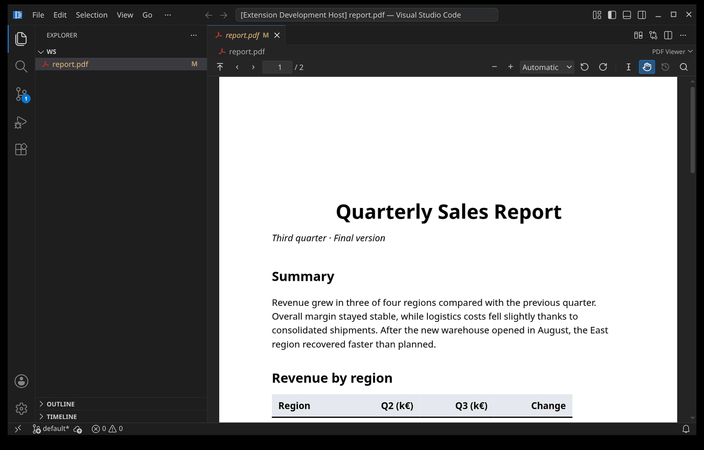
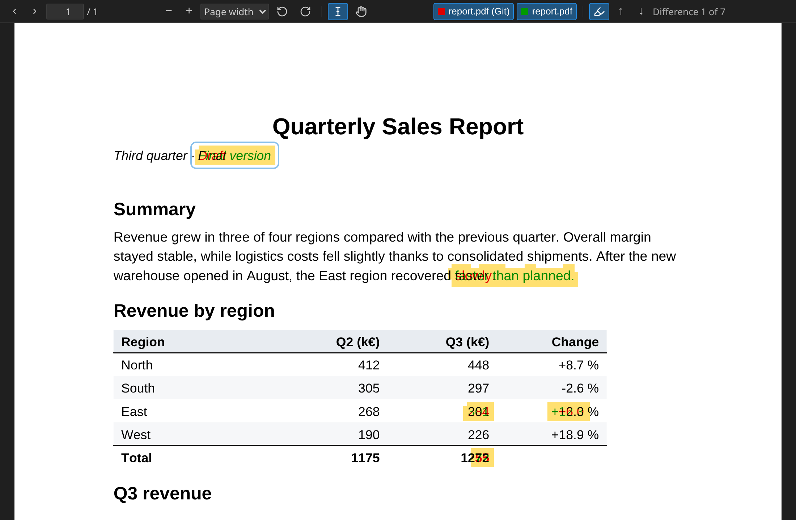

# PDF View & Compare

Displays PDF files directly in the editor and compares two PDFs visually. Rendering is done by [pdf.js](https://mozilla.github.io/pdf.js/).

> **Author's note:** You can of course use this extension just to view PDFs, but I designed it
> for developing them: PDFs that are regenerated often, where you keep looking at particular
> places in the document. I also wanted to see what has actually changed, especially before
> committing a PDF. A side-by-side view was not enough for that, because I still had to hunt
> for the differences myself.



## Features

- Opens `*.pdf` files automatically in a custom editor
- Page navigation and zoom: toolbar buttons, `Ctrl`+mouse wheel, `Ctrl`+`+` / `-` / `0`, fit to page width or whole page
- Rotate left / right
- Drag the page with the mouse (hand tool, the default), or switch to text selection
- Back to the start with one button: page 1, automatic zoom, scrolled to the top left
- Full-text search (search button or `Ctrl`+`F`, then `Enter` / `Shift`+`Enter` for the next / previous match, `Escape` to close)
- Clickable links, including jumps within the document
- Reloads automatically when the file changes on disk, e.g. after a LaTeX build; page, zoom and rotation are kept
- Compare the current file with the version shown before the last reload
- Compare any two PDFs (see below)
- Reads files through the VS Code file system API, so remote and virtual file systems work as well

Password-protected PDFs are not supported; an error message is shown instead.

## Comparing PDFs

There are four ways to start a comparison:

- In the Explorer, select two PDF files, right-click and choose **Compare PDF with…**.
- With a PDF open, use the compare button at the top right of the tab bar, or run the command **PDF View & Compare: Compare PDF with…**, and pick the second file.
- Open a diff of two PDFs anywhere in VS Code, e.g. by clicking a changed PDF in the **Source Control** view or with **Compare Selected** in the Explorer. The comparison replaces the diff editor, which would only show the two files side by side. PDFs stored in Git LFS work too; the committed version is fetched with `git lfs smudge`, so Git LFS has to be installed.
- After an open PDF has been reloaded because it changed on disk, the clock button in the viewer toolbar compares it with the version shown before the reload. That earlier version is kept in memory only.

### What you see



The two files are compared page by page (page 1 with page 1, and so on) by rendering both and comparing the pixels. An inserted page therefore makes all following pages show up as different.

Unchanged areas are left exactly as they are. Only where the pages differ are the two versions laid on top of each other:

- content only in the first file is red,
- content only in the second file is green,
- content present in both is black.

Coloured content inside a differing area is tinted too; hide one of the files to see it in its original colours. If the page sizes differ, the pages are aligned at the top left corner, not scaled.

When the comparison opens, it jumps to the first difference. A connected differing area counts as one difference; a page that exists in only one file counts as one difference.

### Toolbar

- **File name buttons** (red / green square): show or hide that file. With only one file visible it is shown in its original colours.
- **Highlighter**: show or hide the yellow background behind differing areas.
- **Arrows**: frame the previous / next difference and scroll to it if it is not completely visible. The total number of differences is shown next to them.
- Without differences these buttons are disabled.
- Page navigation, zoom, rotation, the hand tool, the button to go back to the start and the text search work as in the normal viewer.

### Problems view and keyboard

The differences are also listed in the **Problems** view of VS Code, with the page number as line number.

While a comparison is the active editor, these keys jump between differences:

| Key | Action |
| --- | --- |
| `F8` or `Alt`+`F8` | Next difference |
| `Shift`+`F8` or `Shift`+`Alt`+`F8` | Previous difference |

The same actions are available as the commands **PDF View & Compare: Go to Next Difference** and **PDF View & Compare: Go to Previous Difference**.

Clicking an entry in the Problems view only brings the comparison to the front; it does not jump to that difference.

### Lifetime of a comparison tab

- The tab is named `compare: a.pdf ↔ b.pdf`, or `compare: a.pdf (git)` for a diff from Source Control and `compare: a.pdf (before)` for the version before the last reload.
- Comparing the same two files again brings the open tab to the front, also if it is in another editor group. Comparing with the version before the last reload again updates the open tab with the newer snapshot.
- If one of the files changes on disk, the comparison is updated; the scroll position is kept.
- The tab closes by itself when one of the files has been deleted (and is still missing two seconds later), or when a comparison with an in-memory earlier version is restored after a restart of VS Code.

## Development

```sh
npm install
npm run compile
```

Then press `F5` in VS Code to start an Extension Development Host.

The extension code is in `src/extension.ts`. The webviews are plain JavaScript modules in `media/`: `viewer.js` for the normal viewer, `compare.js` for the comparison and `common.js` for code shared by both.

## Installing

```sh
npx vsce package
code --install-extension pdf-viewer-diff-0.1.3.vsix
```

## License

[MIT](LICENSE). The bundled pdf.js is licensed under the Apache License 2.0; see [THIRD-PARTY-NOTICES.md](THIRD-PARTY-NOTICES.md).
